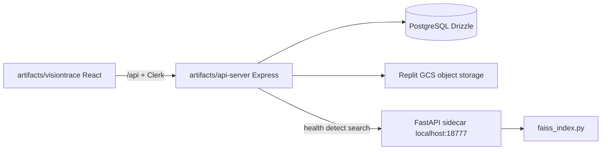

# VisionTrace AI — Architecture Audit and Phased Implementation Plan

No files will be modified until this plan is approved. Implementation will follow the requested phase order, starting with verified YOLO and OSNet inference.

## Current architecture (preserved)

Monorepo: Vite/React UI, Express API, Drizzle schema, Python 3.12 ML sidecar spawned by [`artifacts/api-server/src/lib/mlSidecar.ts`](artifacts/api-server/src/lib/mlSidecar.ts). Clerk on the API; `@clerk/react` is a frontend dependency but **not mounted**. Schema is applied with `drizzle-kit push` (no versioned SQL migrations).

---

## 1. Implemented

- App shell and screens: Search `/`, Library `/library`, Jobs `/jobs`, Datasets `/datasets` in [`artifacts/visiontrace/src/App.tsx`](artifacts/visiontrace/src/App.tsx). UI is API-driven (no mock product data).
- Owner-scoped Express routes, Clerk middleware, private upload request + verified download ([`artifacts/api-server/src/routes/storage.ts`](artifacts/api-server/src/routes/storage.ts), [`visiontrace.ts`](artifacts/api-server/src/routes/visiontrace.ts)).
- PostgreSQL tables: `vision_source_videos`, `vision_indexed_frames`, `vision_person_detections`, `vision_reid_embeddings`, `vision_processing_jobs`, `vision_completed_searches`, `vision_dataset_imports`, `vision_private_uploads`.
- Image detection and image-to-video search **code paths** that call the ML sidecar and join FAISS `vectorId` to Postgres with `owner_id` filtering.
- FastAPI runtime: Ultralytics YOLO (COCO class 0), torchreid `osnet_x1_0`, L2-normalized embeddings, verification JSON gate, FAISS `IndexIDMap2(IndexFlatIP)` with atomic save ([`ml/app.py`](artifacts/api-server/ml/app.py), [`ml/faiss_index.py`](artifacts/api-server/ml/faiss_index.py)).
- Verification CLI at [`artifacts/api-server/ml/verify_models.py`](artifacts/api-server/ml/verify_models.py).
- Dataset **metadata listing** for MARS / MSMT17 / Market-1501 (always `adapterStatus: "planned"`).
- CPU PyTorch, OpenCV, FAISS, FastAPI declared in [`pyproject.toml`](pyproject.toml).

## 2. Partially implemented

- **Video registration:** creates a `vision_source_videos` row and a job, then immediately marks both `failed` (`stage: "blocked"`). No frame extraction.
- **Image search:** correct join + score semantics, but FAISS is never populated from ingestion, so results are empty even when models are ready.
- **Jobs UI:** shows up to 5 `recentJobs` from overview; no worker, retry, or cancel.
- **Hit playback:** seeks `<video>` to `timestampSeconds`; needs authenticated media URLs and indexed frames.
- **Runtime health:** `/api/visiontrace/runtime` is live and **unauthenticated**.
- **Verification:** records hashes + embedding dim, but `_load_models()` requires an existing valid verification file — **first-run chicken-and-egg**.
- **Object storage:** Replit GCS sidecar at `127.0.0.1:1106` only; no local filesystem backend for this Linux host.
- **Clerk:** API expects sessions; UI never wraps `ClerkProvider`, so protected routes 401.

## 3. Missing

- `ultralytics` and `torchreid` not in [`pyproject.toml`](pyproject.toml); no `models/` weights in git (correct) and no documented fetch commands beyond env names.
- YOLO confidence / `imgsz` env config; tracking (`trackletId` always `null`).
- Writers for frames, detections, embeddings; FAISS `/vectors/*` never called from Node.
- Background worker / durable queue (table only).
- Video-to-video and tracklet search (video search always 503).
- Dataset parsers, import, training, evaluation, model registry, activation/rollback.
- Embedding model version / preprocessing / index schema on `vision_reid_embeddings`.
- Video checksum, fps, dimensions, media type columns.
- FAISS delete/invalidate; index rebuild-from-DB job.
- Tests, GitHub CI, Docker; `.env.example`.
- Model-management UI; dataset import UI disabled because status is never `"supported"`.

## 4. Defects and integration problems

- Verification bootstrap: [`verify_models.py`](artifacts/api-server/ml/verify_models.py) calls `_detect` → `_load_models()` which 503s until verification exists.
- Video register always fails even if `runtime.status === "ready"`.
- Dataset import always fails with `adapter_not_verified`.
- OpenAPI claims queued indexing / 202 video search; code does not.
- FAISS empty rebuild may not clear a stale file (`_save` no-ops when `index is None`).
- Corrupt FAISS file can crash sidecar import.
- `callMl` 30s timeout is too short for later video jobs (jobs must not use that request path).
- `customFetch` is cookie-oriented; without Clerk there is no session. Media ``/`<video>` also need authenticated GETs.
- README claims “Clerk-backed sign-in” while [`main.tsx`](artifacts/visiontrace/src/main.tsx) has no Clerk.

## 5. Security and data-integrity risks

- Unauthenticated runtime capability disclosure.
- ML sidecar has **no auth**; safe only on `127.0.0.1`. `/vectors/add` can poison the index if `VISIONTRACE_ML_URL` is a shared host.
- Global FAISS index; tenant isolation is PG join only (must remain).
- No checksum/version on embeddings → mixing embedding spaces after model change.
- Deleting a video cascades PG rows but **not** FAISS IDs.
- Replit storage credentials tied to sidecar; local misconfig fails closed (good) but blocks all media.
- CORS `origin: true` + credentials.

## 6. Dependency and model compatibility

| Piece | Finding |
|-------|---------|
| Python | `>=3.12`; lock uses CPU torch 2.14.1 |
| YOLO | Code expects Ultralytics + `models/yolo11n.pt`; package **not installed** |
| OSNet | `torchreid.utils.FeatureExtractor` + `osnet_x1_0`; **torchreid not installed** and often lags new torch |
| OpenCV | `opencv-python-headless>=5.0.0.93` |
| FAISS | `faiss-cpu>=1.15.1` (cp310-abi3, OK on 3.12) |
| uv sources | Huge `[tool.uv.sources]` template mapping almost every package to the PyTorch CPU index — high risk when adding `ultralytics` |
| License | YOLO11 weights: Ultralytics (AGPL-3.0). OSNet/torchreid zoo: typically MIT. Document; do not commit binaries |

**Phase 2 strategy:** add `ultralytics` via PyPI (not the pytorch-cpu index). For OSNet, try `torchreid`; if it fails on torch 2.14 / 3.12, vendor a small eval-only OSNet loader that still consumes official `osnet_x1_0.pth` (512-d). Do not auto-download weights at app start. Document exact URLs and SHA256 after first successful verification.

---

## Design decisions (locked unless you object)

- **Do not rewrite** UI, Clerk API, Drizzle schema, or FAISS metric (cosine via L2-normalized inner product).
- **Jobs:** smallest durable worker — Node process polling `vision_processing_jobs` with `FOR UPDATE SKIP LOCKED`. No Redis. Python remains inference-only; Node is metadata source of truth.
- **Ingestion:** Node claims job → reads private object to a temp file → ML endpoints for frame sample / detect / embed (batch) → insert frames/detections/embeddings → `POST /vectors/add` with `vector_id`. Single writer for FAISS (the worker).
- **Local storage:** add a filesystem object-store backend when `PRIVATE_OBJECT_DIR` is a local directory (this machine is not Replit GCS). Keep GCS path for Replit.
- **YOLO fine-tuning:** deferred unless a compatible detection dataset appears. OSNet fine-tune is Phase 9, explicitly invoked, never on upload/startup.
- **Tracking:** Phase 7, ByteTrack via Ultralytics `track` when available; track IDs scoped per video/job, never treated as identity.
- **Training vs inference:** separate tables/commands; active model changes only via explicit activation after verification.

Schema extensions (via Drizzle, then `pnpm --filter @workspace/db run push`):

- Videos: `sha256`, `sizeBytes`, `contentType`, `fps`, `width`, `height`, `sampleFps`.
- Embeddings: `modelVersion`, `embeddingSpace`, `indexStatus` (and refuse mixed spaces in one FAISS file).
- Later: `vision_model_artifacts`, `vision_training_runs`, richer `vision_dataset_imports` validation fields.

---

## Phases, acceptance, verification

### Phase 1 — Audit and plan (this document)

**Done when:** you approve. No code changes.

### Phase 2 — Compatible ML deps, weights, verification

- Fix verification bootstrap: load models for the CLI without requiring an existing verification record; keep HTTP inference gated.
- Add `ultralytics`; resolve OSNet runtime (torchreid or vendored loader).
- Configurable `VISIONTRACE_YOLO_CONF`, `VISIONTRACE_YOLO_IMGSZ`.
- Harden FAISS load against corruption; empty rebuild must clear the file.
- Document weight acquisition; `.gitignore` `models/*.pt`, `*.pth`, `data/*.faiss`.

**Accept:** `python3.12 artifacts/api-server/ml/verify_models.py --image <authorized-person.jpg>` prints `success: true`, writes `data/model-verification.json`, hashes match files, embedding dim > 0. `GET /healthz` on sidecar reports `status: ready` only after that.

**Blocker:** you must supply (or authorize download of) YOLO + OSNet weights and one authorized sample image. No fabricated verification.

### Phase 3 — Preprocess, detect, embed

- Shared crop validation, OSNet 256×128-style preprocess as required by the loaded checkpoint, finite-vector checks, recorded preprocess id in verification JSON.
- ML unit tests with fixtures (invalid image, empty crop, dim/NaN rejection) plus a gated live-inference test if weights exist.

**Accept:** `pytest artifacts/api-server/ml/tests -q` (mocked + live-skip). Detect-image returns real boxes; embed matches verification dim.

### Phase 4 — Video registration, frame extraction, jobs

- Register video as `queued` when runtime is ready (not auto-fail).
- Worker: validate container/signature, probe duration/fps/size with OpenCV, sample at configurable FPS (default 1), persist progress, resume from last frame, stages: queued → validating → extracting → detecting → embedding → indexing → completed | failed | cancelled.
- Local filesystem storage adapter.

**Accept:** upload + register authorized sample video → job progresses without the browser staying open; `vision_indexed_frames` rows have timestamps; failure leaves `failed` not `completed`.

### Phase 5 — Postgres embeddings + FAISS

- Insert detections + embeddings with model/space version; incremental `/vectors/add`; skip duplicates; rebuild from valid rows; delete/invalidate on source delete.
- Lock/single-writer; recover partial add (PG commit then FAISS, or transactional outbox in `indexStatus`).

**Accept:** After ingestion, FAISS `ntotal` equals indexed embedding count; rebuild from DB matches; search disabled if verification stale or space mismatch.

### Phase 6 — Image-to-video search E2E

- Keep existing search join; handle no person / multi-person / empty index / unauthorized.
- Wire Clerk on the frontend (`ClerkProvider`, sign-in, credentials on media).
- Playback at match timestamp against real object URLs.

**Accept:** Authorized query image of a person who appears in indexed footage returns those frames with real cosine scores and working seek. Scores labeled as similarity, not identity probability.

### Phase 7 — Tracking

- Per-video tracklets; persist `trackletId`; start/end timestamps; independent tests.

**Accept:** Consecutive frames of the same person share a video-scoped track id; IDs do not leak across videos.

### Phase 8 — Video-to-video and tracklet search

- Query video → sample/detect/embed → FAISS → group by video/tracklet, adjacent-frame collapse, documented temporal aggregation.
- Select indexed detection/tracklet and search.

**Accept:** Video search no longer 503; results authorized and grouped; documented sampling/threshold effects in README.

### Phase 9 — Datasets, training, fine-tune

- Parsers for actual MARS / MSMT17 / Market-1501 layouts (no assumed shared schema); dry-run; no auto-download; no invented camera/time metadata.
- Import into **benchmark** tables, not `vision_source_videos`.
- Explicit OSNet fine-tune CLI: splits, seed, checkpoints, early stop, CPU/GPU, resource checks. Do not activate on completion.

**Accept:** Parser tests on fixture trees; import with configured root is auditable/resumable; training command refuses missing GPU/disk rather than corrupting checkpoints. Skip live training if no authorized dataset root.

### Phase 10 — Model registry, eval, activation, rollback

- PG registry + artifact store (not git); states registered → … → verified → active | retired | failed.
- Rank-1/5/10 + mAP on official protocols when datasets exist.
- Activation requires verification; embedding-space change forces reindex workflow.

**Accept:** Cannot set active without verification; restart keeps the same active hashes; incompatible index refused until rebuild.

### Phase 11 — Frontend

- Connect library/jobs/datasets to real statuses; enable import when adapter is `"supported"` after a passing dry-run.
- Admin-only model panel (or documented CLI if no admin role exists — Clerk `userId` only today: gate via `VISIONTRACE_ADMIN_USER_IDS`).
- Person selection, filters, score disclaimer, timestamp playback.

**Accept:** No hardcoded production results; video search and indexing flows work in the existing visual design.

### Phase 12 — Security, performance, tests

- Owner isolation tests; deletion invalidates FAISS; upload limits; path traversal; ML still localhost-only or shared-secret header if `VISIONTRACE_ML_URL` is remote.
- Unit / integration / E2E as specified in the brief; distinguish mocked vs live inference tests.
- Browser verification of search, library, jobs, playback.

### Phase 13 — Docs and deploy readiness

- Env matrix, weight setup, migrations (`db push`), commands, backup (PG + FAISS + objects + artifacts), troubleshooting.
- Honest production-readiness: only after live inference, search, and security tests pass.

---

## Highest-risk blockers (need your environment)

- Authorized **YOLO + OSNet weight files** and a **sample person image** for verification.
- Authorized **sample video** for ingestion/search tests.
- Optional authorized local dataset roots for Phase 9 metrics (otherwise parsers + fixtures only; no fake mAP).
- Clerk keys for UI sign-in.

After approval, work starts at Phase 2: fix verification bootstrap, install compatible detector/Re-ID packages, and run the real verification command before any search-pipeline claims.
